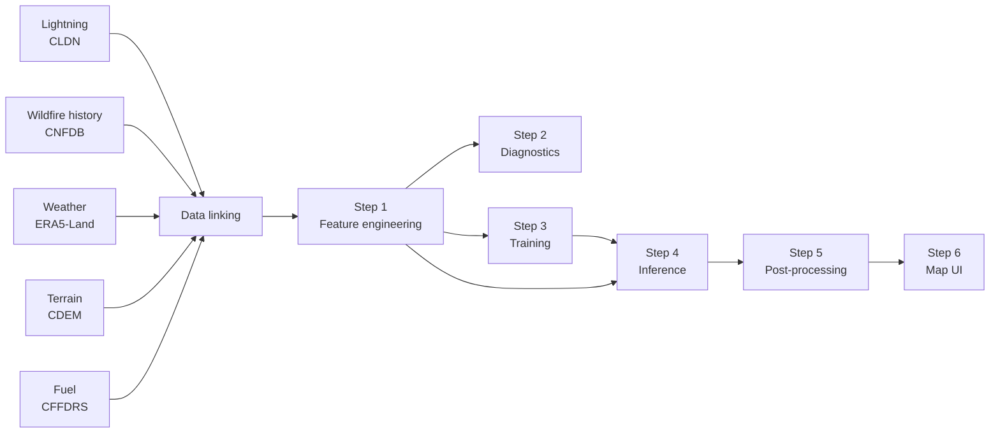

# FireCast: Lightning-Conditioned Wildfire Ignition Prediction

FireCast estimates the probability that an individual lightning strike will start a wildfire. It combines lightning, weather, fuel, terrain and wildfire history data for Alberta and British Columbia, trains an XGBoost classifier, and displays each strike on an interactive risk map.

Capstone project for ELEC 49X (Computer Engineering) at Queen's University, 2026. 1st place, Electrical and Computer Engineering Capstone Competition.

This repository contains the pipeline code only. The lightning data and everything derived from it, including the trained model, are licensed and not included. See [Data licensing](#data-licensing).

## Motivation

Roughly 45% of Canadian forest fires are started by lightning, and those fires account for about 81% of the area burned. They often ignite in remote areas where detection is slow. Existing tools such as the Canadian Forest Fire Danger Rating System (CFFDRS) provide a regional danger index, but cannot say whether a specific strike is likely to ignite. FireCast scores each strike so crews can check the riskiest ones first.

## Pipeline



**Data linking** (done beforehand, not part of this repository). Each lightning-caused fire in the CNFDB is matched to a nearby cloud-to-ground strike shortly before ignition. That strike is labelled an ignition and every other strike a non-ignition. Each strike is then joined with terrain (elevation, slope, aspect), the dominant fuel type around the strike, and ERA5-Land weather at strike time, 1 and 2 hours before, and as a 24-hour average.

| Step | Script | What it does |
|---|---|---|
| 1 | `step1_feature_engineering.py` | Adds engineered features, drops identifiers and extra lags, and splits strikes into Alberta and BC using province boundaries |
| 2 | `step2_diagnostics.py` | Reports class balance, label issues, missing values and the column list for a processed file |
| 3 | `step3_train_model.py` | Tunes XGBoost with Optuna to maximise AUPRC, then retrains on 20 random train/validation/test splits and keeps the model with the best validation AUPRC. Also writes SHAP, calibration and precision-recall plots |
| 4 | `step4_inference.py` | Scores strikes, writes metrics, and draws SHAP decision plots for selected predictions |
| 5 | `step5_postprocess_for_ui.py` | Keeps Alberta strikes and downsamples non-ignitions to a 1:10 ratio for the map |
| 6 | `step6_map_app.py` | Streamlit and PyDeck map that colours each strike by risk level |

`run_pipeline.py` runs the steps in order. `src/common.py` holds the shared paths, fuel type encoding and province lookup.

### Engineered features

| Feature | Definition | Intuition |
|---|---|---|
| `hot_dry_index` | skin temperature / (top-layer soil moisture + 0.01) | Hot surface over dry fuel |
| `thermal_gradient_proxy` | skin temperature - deep soil temperature | Heat at the fuel surface |
| `thermal_stress` | skin temperature - 2 m air temperature | Surface heating relative to the air |
| `moisture_drying_rate` | soil moisture 24 h ago - soil moisture now | How fast fuels are drying |
| `evaporative_wind_stress` | skin temperature x wind speed | Wind-driven drying |

### Risk levels in the map

| Risk level | Ignition probability |
|---|---|
| No risk | 0.50 or less |
| Low | above 0.50, up to 0.60 |
| Mid | above 0.60, up to 0.75 |
| High | above 0.75 |

## Usage

Requires Python 3.11 or newer.

```bash
git clone https://github.com/<your-username>/<repo-name>.git
cd <repo-name>
pip install -r requirements.txt
python run_pipeline.py --help
```

The pipeline expects linked input files that are not included here: `data/combined_ignition_enriched*.csv` and `data/combined_nonignition_enriched*.csv`. Inference also expects a trained model at `model/xgb_mac_v2_Mar15_AB.joblib`, which you can produce with step 3.

```bash
python run_pipeline.py --all            # steps 1, 2, 4, 5 and 6
python run_pipeline.py --all --inputs all
python run_pipeline.py --train-quick    # check that training runs, on a small subsample
python run_pipeline.py --train          # full training (several hours on a CPU)
python run_pipeline.py --ui             # map UI only
```

Training writes to `outputs/training_artifacts/` and never overwrites `model/`.

The map UI works with any CSV that has `strike_lat`, `strike_lon` and `ignition_probability` columns. `strike_date` and `dataset_type` are used if present.

## Data sources

| Source | Provides | Access |
|---|---|---|
| Canadian Lightning Detection Network (CLDN) | Strike time, location, polarity, peak current | Research licence from Environment and Climate Change Canada |
| Canadian National Fire Database (CNFDB) | Historical fires with cause, date and location | Open |
| ERA5-Land (ECMWF) | Hourly temperature, soil moisture, wind, albedo and more | Open |
| Canadian Digital Elevation Model (CDEM) | Elevation, slope, aspect | Open |
| CFFDRS fuel types | Fuel type at 30 m resolution | Open |

## Data licensing

CLDN data is provided by Environment and Climate Change Canada (ECCC) under a research licence that does not allow it to be published or redistributed. For that reason this repository does not include:

- the raw or linked lightning data, or the processed training files
- pipeline outputs (predictions, metrics, plots), which contain strike times and locations
- the trained model, which is derived from the licensed data

The `.gitignore` is an allowlist, so only the scripts and documentation can be committed. To run the pipeline you need your own CLDN licence from ECCC, linked with the open sources above.

## Limitations

- **Region and period.** The model is trained on Alberta only and should be retrained before use in another region or period.
- **Label noise.** Ignitions are matched to strikes by distance and time. During storms many strikes fall close together, so some labels may be wrong.
- **Class imbalance.** Ignitions are rare compared with non-ignitions. Class weighting helps, but rare-event performance can be unstable.
- **Data linking not included.** The linking scripts ran for 20 to 40 hours over more than 100 GB of weather data and are not part of this repository.

## Future work

- Better strike-to-ignition matching and more data from BC and other regions
- Feature pruning, ablation studies, and comparison with neural and geospatial models
- Ranked strike lists and route planning for inspection crews
- Real-time ingestion and an API for wildfire agencies

## Acknowledgements

We wish to thank Environment and Climate Change Canada for their generous permission to use Canadian Lightning Detection Network (CLDN) data.

## Team

Team 28, ELEC 49X, Queen's University (2026): Erik Sachik, Toby Salamon, Charles Debane, Simon John.
